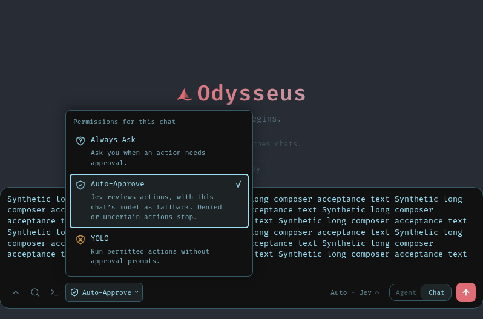
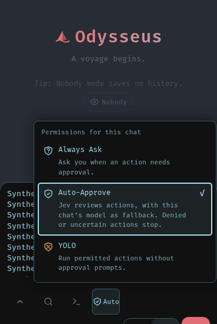

# Fork Regression Suite

This is the reusable acceptance catalogue for the fork. [cases.json](cases.json)
contains 152 concrete scenarios: prerequisites, actions, observable pass criteria,
evidence, existing test references and historical failure links. It covers every
current product area, the fork's provider/Auto/approval/workspace changes, and
deployment/platform boundaries. It cannot enumerate every possible input or
certify integrations that have not been exercised.

The scope is behavior: actual app/API/browser/native execution and provider
responses. Syntax checks, source snapshots and fixture assertions remain useful
supporting gates, but they are not live acceptance results.

## What to run

| Layer | Entry point | What a pass establishes |
| --- | --- | --- |
| Existing automated tests | [automated-inventory.json](automated-inventory.json), `python -m pytest -q tests` in the qualified offline environment | The listed tests passed under that environment; inspect skips and prerequisites. |
| Deterministic running app | [tests/smoke](../../../tests/smoke/README.md), through the existing `scripts/odysseus-smoke` launcher | Real app routes/CRUD/provider transport work against synthetic services; the model is a stub. |
| Fork live acceptance | `scripts/fork_live_tests.py`, described below | Exact deployed source, real state, persisted providers and selected actual model/native execution for the chosen suite. |
| Live browser | `UI-*`, Notes/editor cases in the catalogue | Actual deployed desktop/mobile interaction and rendered pixels, with captures and timings. |
| Optional/external/platform | Remaining catalogue procedures | Only the explicitly provisioned service/platform/profile that was actually exercised. |

Keep the existing automated tests and smoke suite. The new runner extends them
for the current operator deployment; it does not copy their fixture backend,
bootstrap instances, install dependencies, or replace their browser workflows.

## Enumerate all existing automated tests

The committed inventory lists every file under `tests/`, with content hashes and
Python test-definition counts. It distinguishes pytest files, JavaScript scenario
and support sources, and remaining fixtures/support files. This includes standalone
browser scenarios with unconventional names; support-file counts are not test-case
counts. Symlinks and generated caches are excluded. Regenerate after test changes:

```sh
python scripts/fork_regression_inventory.py --output docs/testing/fork-regression/automated-inventory.json
python scripts/fork_regression_inventory.py --nodes --output /private/artifacts/test-definitions.json
python -m pytest --collect-only -q tests > /private/artifacts/collected-tests.txt
```

The first two commands parse files without importing them. Definition counts do
not expand parametrizations, dynamic tests, fixtures or skips; pytest collection
in the qualified runtime owns the executable node list. Existing browser tests
also require their declared browser/runtime. Use retained tools and the existing
CI environment; this suite adds no dependencies or package-executor commands.

## Run against a selected deployment

Use the deployment's test/admin account in a private JSON file with `username`
and `password`, mode 0600. Never put
passwords or provider keys in command arguments or committed files. Provider
keys stay in the app's encrypted registration. The runner accepts only a literal
loopback HTTP origin or a protected app Unix socket, refuses redirects, ignores
ambient proxies, pins the expected source before authentication, and writes
sanitized JSON results. It does not retry failed model or tool operations.

```sh
python scripts/fork_live_tests.py \
  --origin http://127.0.0.1:7824 \
  --login-file "$LOGIN_FILE" --expected-source "$SOURCE_SHA" \
  --suite read --output /private/artifacts/read.json
```

With protected IPC, add `--socket /run/selected-app/odysseus.sock`. Run the client
in a separate task-owned container with only that socket, its scoped login file,
read-only runner and an output directory. No SSH, Git, keyring or general host
home is needed. The app continues to enforce its native process containment.

| Suite | Additional arguments | Actual effects and checks |
| --- | --- | --- |
| `read` | None | Login/logout, exact version, health/readiness, anonymous denial and credential-free model picker inventory. |
| `state` | `--endpoint-id "$ENDPOINT_ID" --model "$MODEL_ID"` | Creates/deletes uniquely labelled test chats; new Auto-Approve default, persistence across login, explicit mode/CAS, exact context model and workspace. No inference. |
| `crud` | Same as `state` | Also creates, edits, restores and deletes its own Notes/document records. No mail, calendar, task, provider-key or owner-preference edits. |
| `provider` | Same as `state` | Also refreshes the selected saved-key catalogue and performs one actual one-round model greeting, checking actual model and saved assistant history. This can incur provider charges. |
| `native` | Same as `state` | Also requests one exact unique `printf/cat/rm/test` action through Auto-Approve. Requires a working reviewer and qualified native sandbox. This can incur model/reviewer charges. |

For a known context, add `--expected-context 262144` or the exact measured value
for the chosen provider/account/model. Run `provider`/`native` separately for
each intended model, including Gemma, the selected complex model and OpenAI.
If the owner's saved routing uses Auto, also pass `--manual-template "$SESSION_ID"`
for an owned disposable Manual chat already using that exact provider/model,
with optional followup/preparation/completion
calls off. The runner forks it with zero history, resets grants through the real
fork flow, and sends the selected model/endpoint explicitly. It never changes
the source template or the owner's Auto defaults. Without a suitable template,
an Auto test chat stops before inference rather than silently testing whichever
model Jev routes it to. Prepare model-specific Manual fixtures in a disposable
deployment/state copy; changing a chat's model or route normally also remembers
the owner's future defaults. Do not switch a user's live defaults merely to
make a provider test pass.
Do not silently substitute a model after a failure. The native oracle requires
one successful exact Bash receipt, exact stdout and successful final absence
test; an assistant's statement that it wrote/deleted a file does not count.

State/CRUD cases clean up only IDs returned from their own creation requests.
Cleanup failure is a failed case. Native actions use a unique
`fork-regression-*.txt` file in the selected ordinary workspace. A failed or
interrupted native action can leave that named scratch file; record and remove
only that exact owned file after inspecting the failed receipt. Do not run
external-effect cases against real inboxes, contacts, scheduled deliveries or
user files. Those procedures require synthetic services/state copies.

## Debian deployed suite

`scripts/debian_deployed_tests.py` runs live checks plus fork/mode/category/admission checks and writes the complete 152-case matrix with each historical problem linked to its outcomes. Copy `debian-plan.example.json` to a private operator directory and set the exact deployed source SHA and registered endpoint/model IDs:

```sh
python scripts/debian_deployed_tests.py --plan "$PLAN_FILE" --login-file "$LOGIN_FILE" --socket "$APP_SOCKET" --profiles core,extended --isolated-state --output "$ARTIFACT_DIR/debian.json"
```

Extended, provider and native profiles require a disposable deployment/state copy. Add `provider` or `native` and `--allow-paid` for bounded model calls. Each model is tested independently; a failed greeting prevents its native action. Other selected variants retain their own results. If a provider resolves an alias to a dated snapshot, declare its exact `reported_model` in the plan; there is no implicit alias guessing or provider substitution. The runner needs the protected app socket and one private login file; it needs no SSH, engine socket, provider key or host home. Keep the owner deployment separate.

`scripts/debian_browser_tests.py --origin "$BRIDGE_URL" --expected-source "$SOURCE_SHA" --login-file "$LOGIN_FILE" --isolated-state --output "$ARTIFACT_DIR/browser.json"` uses a preinstalled headless Chromium and real app APIs at desktop and phone widths. It checks long composer controls, repeated permission-menu opening/icons and real scroll scale. Run it from a machine with Chromium over the deployment’s private loopback bridge; login JSON may instead arrive on stdin. It installs nothing and uses a temporary browser profile. The target must be disposable because opening pending-chat permissions can materialize empty test chats.

Supplementary browser/service receipts use schema `odysseus-debian-supplement/v1`, the exact `expected_source`, and `results` containing existing case IDs/status/evidence. Supply them with repeatable `--receipt` arguments; stale revisions and unknown case IDs fail. Unexecuted procedures remain `not_run`. Exit 0 means the complete catalogue passed, 1 means an executed check failed, and 2 means coverage is incomplete. Unit-test references do not become live passes.

`scripts/debian_smoke_tests.py --expected-source "$SOURCE_SHA" --output "$ARTIFACT_DIR/smoke.json"` runs the existing release smoke suite through the ordinary dev launcher in a temporary source/state copy, using prepared dependencies and synthetic model/email services. It disables scheduled effects and vectors, installs nothing, stops its own instance, and records skips. The caller must verify the source export and SHA. Synthetic-service smoke and real-provider acceptance remain separate results.

## Run order and result contract

1. Run focused offline tests for changed behavior and the runner itself. Run the
   relevant existing smoke area on a synthetic-service instance.
2. Deploy the exact reviewed source while retaining the stopped prior generation
   with matching data. Check `read`, then `state` and `crud`.
3. Run bounded `provider` and `native` checks for explicitly selected registered
   models. Capture 400/429, unsupported tool names and review uncertainty as
   failures with their own receipts. Never lower authority controls to pass.
4. Run the relevant desktop and true-mobile browser cases. Then execute external
   service, restart/recovery and platform procedures in their declared profiles.
5. Record every selected case as passed, failed, blocked, skipped or not run,
   with source/environment, oracle evidence and cleanup outcome. A missing
   prerequisite is blocked/skipped, never passed. Stop/review after ambiguous
   execution; do not replay an action automatically.

The CLI exits nonzero if any selected check fails. It emits only counts,
synthetic IDs, exact source/model identifiers and fixed diagnostic codes, not
chat bodies, cookies, reviewer reasoning or credentials. A passing `read` run
does not imply that other suites ran. Preserve the JSON receipts and browser
captures outside the repository and link their summary from the PR/handoff.
Publish only reviewed sanitized summaries.

## Historical failures

The catalogue's 18 history clusters were reconstructed from four retained local
rollouts and the stored history of 15 named Odysseus threads, including older
October 21/24/25/30 and November 4 records plus the current work. Raw logs and
private identifiers stay outside the repository. Debian's host had no retained
Codex rollout files; the workbench's copied bug context is supplementary. A
historical report is a reason to run a case, not proof of a present bug or of a
fix. Provider/harness-fixture failures are recorded separately from app defects.

The linked case list is the maintained inventory of work to execute. Current
run results belong in timestamped receipts/handoffs, not as permanently checked
boxes in this catalogue. Regenerate the automated inventory and add a case when
another concrete failure exposes a missing acceptance oracle.

## Scenario index

The complete steps and pass criteria are in [cases.json](cases.json). The index
below is generated from that file; `runner` cases have a direct CLI entry point,
while `procedure` cases name the actual required app/service/browser exercise.

### Runtime and deployment

| ID | Scenario | Execution |
| --- | --- | --- |
| RT-01 | Readiness and exact source | runner |
| RT-02 | Restart persistence | procedure |
| RT-03 | Bridge recovery | procedure |
| RT-04 | Static asset generation | procedure |
| RT-05 | Unavailable dependency | procedure |
| RT-06 | Cold install matrix | procedure |
| RT-07 | TLS client parity | procedure |
| RT-08 | Resource and recovery limits | procedure |

### Authentication and ownership

| ID | Scenario | Execution |
| --- | --- | --- |
| AU-01 | Anonymous access denied | runner |
| AU-02 | Logout revokes access | runner |
| AU-03 | Login persistence and reset | procedure |
| AU-04 | Cross-owner isolation | procedure |
| AU-05 | CSRF and origin checks | procedure |
| AU-06 | Delegated API scopes | procedure |
| AU-07 | Revocation and privilege change | procedure |
| AU-08 | Credential custody | procedure |

### Approval modes and authority

| ID | Scenario | Execution |
| --- | --- | --- |
| AP-01 | New chat defaults to Auto-Approve | runner |
| AP-02 | Mode CAS and explicit choice | runner |
| AP-03 | Fork default and source preservation | procedure |
| AP-04 | Existing and legacy chat modes | procedure |
| AP-05 | No reviewer path | procedure |
| AP-06 | Jev success | procedure |
| AP-07 | Selected-model technical fallback | procedure |
| AP-08 | Denial and uncertainty | procedure |
| AP-09 | Risk-specific assessment floors | procedure |
| AP-10 | Exact one-use human approval | procedure |
| AP-11 | Expired approval recovery | procedure |
| AP-12 | Owner ceiling and grant revocation | procedure |
| AP-13 | YOLO remains contained | procedure |
| AP-14 | Nearest trusted request | procedure |
| AP-15 | Concurrent mode changes | procedure |

### Providers, models and Auto routing

| ID | Scenario | Execution |
| --- | --- | --- |
| MD-01 | Registered picker inventory | runner |
| MD-02 | Saved-key catalogue refresh | runner |
| MD-03 | Auto categories persist | procedure |
| MD-04 | Manual selection preserves pair | procedure |
| MD-05 | No stale manual bootstrap | procedure |
| MD-06 | Same model in both categories | procedure |
| MD-07 | Unavailable selected assignment | procedure |
| MD-08 | Model and effort dispatch | procedure |
| MD-09 | Google effort compatibility | procedure |
| MD-10 | OpenAI payload compatibility | procedure |
| MD-11 | Unknown model capabilities | procedure |
| MD-12 | Provider/account identity change | procedure |
| MD-13 | Rate limit and transient failure | procedure |
| MD-14 | OAuth and subscription refresh | procedure |
| MD-15 | Local engines and proxy dialects | procedure |
| MD-16 | Endpoint purpose separation | procedure |
| MD-17 | Exact provider probe without changing Auto defaults | procedure |

### Context, budgets and usage

| ID | Scenario | Execution |
| --- | --- | --- |
| CX-01 | Selected model context label | runner |
| CX-02 | Auto execution context | procedure |
| CX-03 | Scoped context evidence | procedure |
| CX-04 | Budget enforcement | procedure |
| CX-05 | Prompt cache usage | procedure |
| CX-06 | Compaction and history safety | procedure |
| CX-07 | Memory/skill injection switches | procedure |
| CX-08 | Usage across reconnect | procedure |

### Chat, streaming and Gemma

| ID | Scenario | Execution |
| --- | --- | --- |
| CH-01 | One-round greeting | runner |
| CH-02 | Buffered and streamed parity | procedure |
| CH-03 | Gemma reasoning tags | procedure |
| CH-04 | Real promised action guard | procedure |
| CH-05 | Native tool names and arguments | procedure |
| CH-06 | Stream detach and reconnect | procedure |
| CH-07 | Stop during generation and tools | procedure |
| CH-08 | Concurrent chats | procedure |
| CH-09 | Message edit, delete and fork | procedure |
| CH-10 | Attachment and Unicode turn | procedure |
| CH-11 | Export and resume | procedure |

### Filesystem, processes and workspace

| ID | Scenario | Execution |
| --- | --- | --- |
| FS-01 | Actual create/read/delete | runner |
| FS-02 | Write durability including network mounts | procedure |
| FS-03 | Empty and binary file semantics | procedure |
| FS-04 | Nested fences and quoting | procedure |
| FS-05 | Windows newline preservation | procedure |
| FS-06 | Workspace default and switching | procedure |
| FS-07 | Traversal and symlink races | procedure |
| FS-08 | Missing containment | procedure |
| FS-09 | Private server-state exclusion | procedure |
| FS-10 | Read-only additional root | procedure |
| FS-11 | One-use process reservation | procedure |
| FS-12 | Background job ownership | procedure |
| FS-13 | Filesystem error and interruption | procedure |

### Browser and interaction

| ID | Scenario | Execution |
| --- | --- | --- |
| UI-01 | Permission menu stability | procedure |
| UI-02 | Composer model control while typing | procedure |
| UI-03 | Sidebar text and icons | procedure |
| UI-04 | Scroll scale and text rendering | procedure |
| UI-05 | Drag and resize responsiveness | procedure |
| UI-06 | Decision panel placement and refresh | procedure |
| UI-07 | Context panel accuracy | procedure |
| UI-08 | Unavailable temperature control | procedure |
| UI-09 | Reload, offline and service worker | procedure |
| UI-10 | Keyboard, touch and reduced motion | procedure |
| UI-11 | Streaming markdown and tool output | procedure |
| UI-12 | Theme and layout persistence | procedure |

### Notes

| ID | Scenario | Execution |
| --- | --- | --- |
| NT-01 | Note CRUD | runner |
| NT-02 | Note recurrence and reminders | procedure |
| NT-03 | Notes desktop/mobile/offline | procedure |

### Documents, uploads and RAG

| ID | Scenario | Execution |
| --- | --- | --- |
| DC-01 | Versioned document restore | runner |
| DC-02 | Attachment bytes and ownership | procedure |
| DC-03 | RAG retrieval with evidence | procedure |
| DC-04 | OCR and optional parsers | procedure |
| DC-05 | Rich content and export | procedure |
| DC-06 | Index deletion and failure recovery | procedure |

### Calendar, contacts, tasks and delivery

| ID | Scenario | Execution |
| --- | --- | --- |
| CA-01 | Calendar event CRUD | procedure |
| CA-02 | Calendar recurrence and DST | procedure |
| CA-03 | CalDAV/CardDAV synchronization | procedure |
| CA-04 | Contact resolution | procedure |
| CA-05 | Task scheduling and pause | procedure |
| CA-06 | Task ownership and webhook token | procedure |
| CA-07 | Delivery idempotency and cancellation | procedure |

### Email

| ID | Scenario | Execution |
| --- | --- | --- |
| EM-01 | List, search and read correct mail | procedure |
| EM-02 | Draft/reply/send boundary | procedure |
| EM-03 | Move, archive and selective delete | procedure |
| EM-04 | Unread and folder state | procedure |
| EM-05 | Mail OAuth and scope | procedure |
| EM-06 | Scheduled mail and cancellation | procedure |
| EM-07 | Injection in mail and attachments | procedure |

### Memory and skills

| ID | Scenario | Execution |
| --- | --- | --- |
| MM-01 | Memory CRUD and search | procedure |
| MM-02 | Memory extraction correctness | procedure |
| MM-03 | Skill create/upload/update/delete | procedure |
| MM-04 | Skill retrieval and audit | procedure |
| MM-05 | Untrusted context and isolation | procedure |

### Search and research

| ID | Scenario | Execution |
| --- | --- | --- |
| SR-01 | Search and source fetch | procedure |
| SR-02 | Deep research lifecycle | procedure |
| SR-03 | Research owner and library CRUD | procedure |
| SR-04 | Search unavailable and rate-limited | procedure |

### Compare and model serving

| ID | Scenario | Execution |
| --- | --- | --- |
| CP-01 | Compare stream, vote and reveal | procedure |
| CP-02 | Compare cancellation and ownership | procedure |
| CP-03 | Cookbook hardware and empty catalogue | procedure |
| CP-04 | Serve start/adopt/stop | procedure |
| CP-05 | Dead serve recovery including Windows | procedure |
| CP-06 | Remote serve validation | procedure |

### Gallery, editor and speech

| ID | Scenario | Execution |
| --- | --- | --- |
| ME-01 | Gallery and generated image ownership | procedure |
| ME-02 | Editor document and undo | procedure |
| ME-03 | Editor mobile and lifecycle | procedure |
| ME-04 | Transcription provider matrix | procedure |
| ME-05 | TTS playback and cancellation | procedure |

### Integrations and MCP

| ID | Scenario | Execution |
| --- | --- | --- |
| IN-01 | MCP discovery and permission filtering | procedure |
| IN-02 | MCP action and cancellation | procedure |
| IN-03 | Companion pairing and revocation | procedure |
| IN-04 | Integration token and tool authority | procedure |
| IN-05 | Webhook authenticity and replay | procedure |

### Private browser and decisions

| ID | Scenario | Execution |
| --- | --- | --- |
| BR-01 | Browser qualification boundary | procedure |
| BR-02 | Observed-node action binding | procedure |
| BR-03 | Browser-required decisions | procedure |
| BR-04 | Complete decision distributions | procedure |
| BR-05 | Completion evidence gate | procedure |
| BR-06 | Decision accounting and export | procedure |

### Settings, persistence and recovery

| ID | Scenario | Execution |
| --- | --- | --- |
| ST-01 | Preferences across logins | procedure |
| ST-02 | Backup and restore round trip | procedure |
| ST-03 | Database migrations and concurrency | procedure |
| ST-04 | Vector data volume recovery | procedure |
| ST-05 | Diagnostics and error redaction | procedure |
| ST-06 | Admin destructive boundaries | procedure |

## Default-mode browser evidence

These composer crops use the actual deployed app at desktop 1440px and mobile 390px with synthetic text, not mocked APIs. Captured from app source `d50a3dd0`; subsequent suite/evidence changes do not alter its application code. They establish pending-composer/menu default and viewport fit, not GPU performance or every browser scenario.





### Additional Debian profiles

Run `scripts/debian_browser_tests.py --origin http://127.0.0.1:7825 --login-file PRIVATE_LOGIN_JSON --expected-source FULL_SHA --isolated-state --output PRIVATE_RESULTS_JSON` using preinstalled Chromium and a private loopback SSH bridge to the disposable deployment. It uses a temporary profile and tests desktop/phone composer visibility, permission icons/opening stability and actual wheel scrolling.

On Debian, `scripts/debian_stop_tests.py --deployment FIXTURE_DEPLOYMENT_JSON --expected-source FULL_SHA --login-file PRIVATE_LOGIN_JSON --endpoint-id SAVED_ENDPOINT_ID --model MODEL_ID --output PRIVATE_RESULTS_JSON` verifies active generation and real native process-tree cancellation. Only the named disposable fixture is permitted. It reads the container namespace with Podman; model actions go through the app's ordinary containment.

Plans optionally select `content_probe: true` for exact write_file/read_file/byte-verification cleanup, `native_delay_seconds: 60` for explicit provider pacing, and `reported_model` for an exact known alias snapshot. None enables automatic action retries or provider substitution.

Combine a previous deployed report with exact-source browser/Stop receipts using `--profiles receipts --previous-report PREVIOUS_JSON --receipt SUPPLEMENT_JSON`. This mode performs no login or model actions. Retain original failed runs, including provider 429s, alongside later probes.
